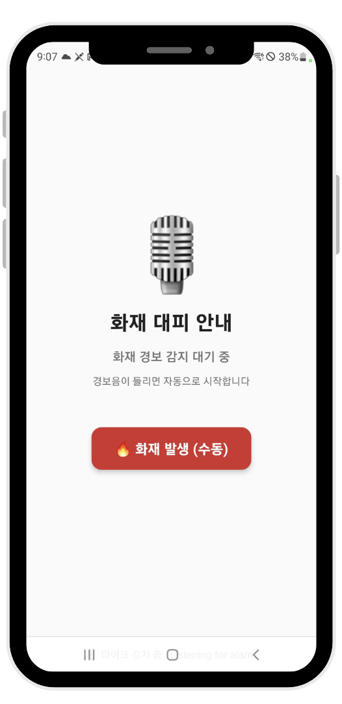
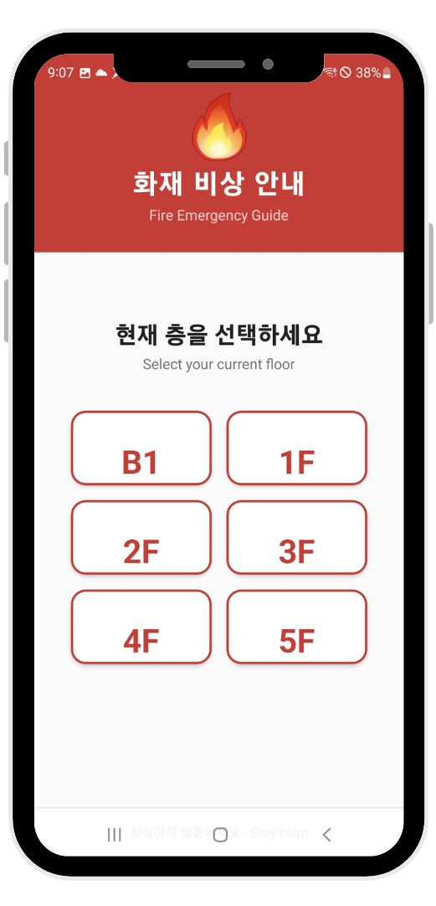
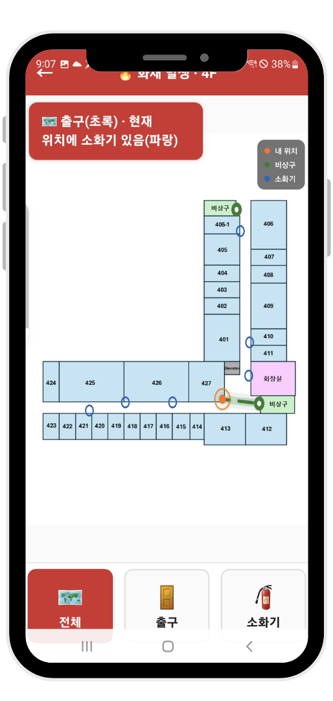
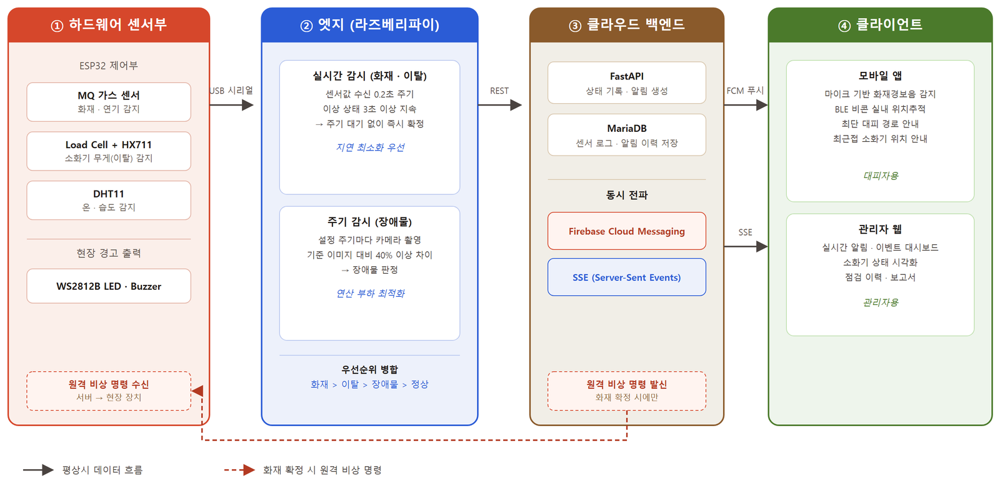

# FireFinder 모바일 앱

화재 경보음을 듣고 자동으로 대피 안내를 시작하는 실내 대피 안내 앱입니다. 건물 안 BLE 비콘으로 현재 위치를 잡고, 가장 가까운 비상구와 사용 가능한 소화기까지의 경로를 평면도 위에 그려 줍니다.

2026년 컴퓨터공학전공 졸업작품 FireFinder(화재 감지·소화기 관리 시스템)에서 대피자용 앱 부분입니다.

## 만든 이유

소화기는 월 1회 정도 눈으로 점검하는 경우가 많아서, 점검 사이에 소화기가 없어지거나 앞이 막혀도 알기 어렵습니다. 불이 났을 때도 경보음을 못 듣거나 건물 구조를 모르면 대피가 늦어집니다. 그래서 센서로 소화기 상태를 상시 확인하고, 화재 시 사람마다 자기 위치 기준으로 대피 경로를 안내하는 시스템을 만들었습니다.

## 배포·데모

- 배포: EAS Build로 Android 앱을 내부 배포했습니다. `expo-updates`가 설정되어 있어 `eas update`로 JS 코드만 바뀐 버전을 OTA로 배포할 수 있습니다.
- 전체 시스템(엣지, 서버, 관리자 웹, ESP32 펌웨어): [ParkRiver614/fire-extinguisher-system](https://github.com/ParkRiver614/fire-extinguisher-system)

## 화면

| 경보음 감지 대기 | 층 선택 | 대피 경로 |
|---|---|---|
|  |  |  |

## 구조와 동작



전체 시스템은 센서가 달린 소화기 받침대(ESP32), 라즈베리파이 엣지, FastAPI 서버, 관리자 웹, 이 앱으로 나뉩니다. 이 저장소는 오른쪽 끝의 모바일 앱입니다.

앱의 흐름은 다음과 같습니다.

1. 앱을 켜면 대기 화면에서 마이크로 주변 소리를 듣습니다. 화재 경보음으로 판단되면 층 선택 화면으로 넘어갑니다. 수동 버튼으로도 넘어갈 수 있습니다.
2. 층을 고르면 서버에 그 층 모든 구역의 비상 경보를 요청합니다. 서버가 현장 장치의 부저와 LED를 울립니다.
3. 지도 화면에서 BLE 비콘으로 현재 위치를 추정하고, 다익스트라 알고리즘으로 가장 가까운 비상구와 소화기까지 경로를 계산해 평면도에 그립니다.
4. 서버의 SSE 스트림으로 소화기 상태를 실시간으로 받아, 이탈·장애물 같은 이상 상태의 소화기는 경로 후보에서 뺍니다.
5. 앱을 처음 실행할 때 Expo 푸시 토큰을 서버에 등록합니다. 서버가 화재를 확정하면 등록된 모든 기기로 푸시 알림을 보냅니다.

## 기술 스택

- React Native 0.81, Expo SDK 54, EAS Build / EAS Update
- react-native-ble-plx (BLE 스캔), expo-av (마이크 음량 측정)
- react-native-sse (서버 이벤트 수신), expo-notifications (푸시)
- react-native-svg (평면도와 경로 그리기), expo-secure-store (토큰 저장)
- 서버 쪽 푸시 토큰 API: FastAPI (`server/routers/push_tokens.py`)

## 주요 기능

- 화재 경보음 자동 감지 후 대피 안내 시작
- BLE 비콘 기반 실내 위치 추정
- 현재 위치에서 가장 가까운 비상구, 사용 가능한 소화기까지 최단 경로 표시 (출구 / 소화기 / 전체 전환)
- B1부터 5F까지 층별 평면도
- 소화기 상태 실시간 반영 (SSE, 연결이 끊기면 5초 후 재연결)
- 층 선택 시 해당 층 현장 경보(부저·LED) 요청
- 푸시 알림 수신

## 개발하면서 정한 것들

경보음 감지는 음량만 봅니다. 200ms마다 마이크 음량을 재고, 최근 2초(10개 샘플) 중 6개 이상이 -20 dB 이상이면 경보음으로 판단합니다. 한 번 큰 소리가 났다고 바로 넘어가지 않게 하려고 슬라이딩 윈도우를 썼습니다.

BLE 위치는 RSSI가 많이 흔들려서 비콘마다 최근 5개 값의 중앙값을 씁니다. 2초마다 계산하고, 비콘이 3개 이상 잡히면 거리 제곱의 역수를 가중치로 한 가중 무게중심으로 위치를 구한 뒤 가장 가까운 지도 노드에 맞춥니다. 2개 이하면 가장 신호가 센 비콘 위치로 둡니다. 거리 변환 상수(1m 기준 RSSI -59, 경로 손실 지수 2.5)는 경험값입니다.

경로는 평면도 위의 노드와 간선으로 그래프를 만들고 다익스트라로 구합니다. 비상구와 소화기가 여러 개라 각각까지 거리를 구한 뒤 가장 짧은 것을 고릅니다.

소화기 상태는 처음에 SSE 연결 직후 오는 스냅샷으로 덮어썼는데, 서버가 알림을 자동으로 해제하지 않아 정상으로 돌아온 소화기가 계속 이상으로 보였습니다. 초기 상태는 REST로 받은 실제 상태를 쓰고, 상태가 바뀔 때마다 오는 `event.created` 이벤트로 정상 복귀를 반영하도록 바꿨습니다.

서버를 학과 서버에서 AWS로 옮기면서 앱의 서버 주소도 바꿨습니다. 같은 시기에 서버 쪽 코드에 박혀 있던 IP를 환경변수로 빼는 수정도 했습니다.

소화기 앞 장애물 판정은 처음에 ESP32-CAM이 찍은 사진을 서버로 보내고, 서버가 YOLOv8n으로 사진 가운데에 물체가 있는지 보는 방식으로 만들었습니다. 최종 시스템에서는 라즈베리파이 카메라로 찍고 엣지에서 기준 사진과 비교해 판정하도록 바꿨고, YOLO는 지나가는 사람을 걸러내는 데만 씁니다. 처음 방식의 서버 코드는 쓰이지 않게 되어 저장소에서 지웠습니다.

## 한계와 다음 단계

- 서버 주소가 코드 네 곳에 그대로 들어 있고, HTTP 평문 통신을 씁니다. 설정 파일로 빼고 HTTPS로 바꿔야 합니다.
- 앱이 공용 서비스 계정 하나로 서버에 로그인합니다. 사용자별 인증이 아닙니다.
- 층 평면도와 노드 좌표가 앱 안에 들어 있어서 다른 건물에 쓰려면 코드를 고쳐야 합니다. 서버에서 층 지도를 받아오는 코드는 있지만, 지금은 모든 층이 앱 내장 데이터를 써서 호출되지 않습니다.
- BLE 위치 오차와 경보음 감지 정확도는 정량적으로 측정하지 않았습니다. 경보음 감지는 음량 기반이라 다른 큰 소리와 구분하지 못합니다.
- SSE 재연결 간격이 5초로 고정되어 있습니다.

## 로컬 실행

BLE 모듈 때문에 Expo Go로는 실행되지 않고 개발 빌드가 필요합니다.

```bash
npm install
```

실행 전에 다음 두 파일이 필요합니다. 둘 다 저장소에 올리지 않습니다.

- `google-services.json`: Firebase 콘솔에서 Android 앱용으로 받은 파일 (프로젝트 루트)
- `src/config/appCredentials.js`: 서버 로그인 계정. `appCredentials.example.js`를 복사해 만들고 값을 채웁니다.

서버 주소는 `src/services/api.js`, `auth.js`, `pushNotification.js`, `src/hooks/useExtinguisherStatus.js`의 `BASE_URL`에서 바꿉니다.

```bash
npx expo run:android            # USB로 연결한 기기에 개발 빌드 설치
# 또는
eas build --profile development --platform android
npx expo start --dev-client
```

## 폴더 구조

```
App.js                    화면 전환 (대기 → 층 선택 → 지도)
src/
  screens/                StandbyScreen, FloorSelectScreen, MapScreen
  components/             FloorMap(평면도·경로 SVG), RouteToggle, EmergencyHeader
  hooks/
    useFireAlarmDetection.js   마이크 음량 기반 경보음 감지
    useBLELocation.js          BLE 스캔, RSSI 처리, 위치 추정
    useExtinguisherStatus.js   SSE로 소화기 상태 수신
  utils/pathfinding.js    다익스트라 최단 경로
  services/               API, 로그인 토큰, 푸시 토큰 등록
  data/floorData.js       층별 평면도 노드·간선·출구·소화기 위치
server/                   서버에 추가한 푸시 토큰 API와 적용 방법
docs/images/              README 이미지
```
